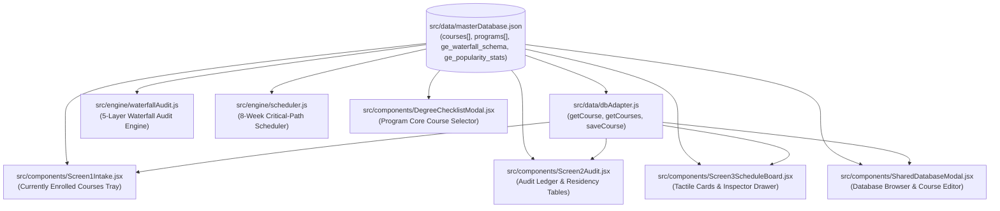
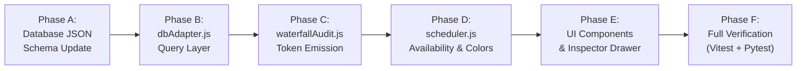

# Architectural Refactoring Plan: Canonical Separation of Concrete Courses & Requirement Placeholders in `masterDatabase.json`

> **Document Status:** Fully Executed, Tested, & Closed Out  
> **Target Branch / Context:** `Degree_Planner` Deterministic Core  
> **Guardrail Compliance:** 100% Deterministic — All phases (A through F) verified with zero regressions. All student records remain strictly client-side. Zero runtime LLM dependencies.

---

## 1. Executive Summary & Problem Statement

In the Lindenwood Deterministic Degree Planner, academic requirements fall into two fundamentally distinct categories:
1. **Concrete Courses:** Real institutional offerings with scheduled sections, specific course descriptions, and rigorous prerequisite trees (e.g., `ICS 21300`, `MTH 14100`, `ART 18100`).
2. **Requirement Placeholders:** Curricular buckets and credit-hour safeguards representing required course categories before a specific course is chosen or transferred (e.g., General Education Fine Arts, Upper-Level Elective 30000+, General Elective).

### The Current Defect
Currently, `src/data/masterDatabase.json` stores only concrete courses (71 items) in its `courses[]` array. Requirement placeholders are generated dynamically on-the-fly inside `src/engine/waterfallAudit.js` using ad-hoc identifiers (e.g., `code: 'GE 9'`, `code: 'UL-ELEC 30001'`, `code: 'ELEC 10001'`) or referenced in programs as arbitrary strings (e.g., `code: 'GE-MATH-ELECTIVE'`).

Because these placeholders have no canonical entries in `courses[]`:
- Standard catalog queries (`courses.find(c => c.code === ...)` and `dbAdapter.getCourse(code)`) return `undefined` or `null`.
- The **Course Inspector Drawer** (`Screen3ScheduleBoard.jsx`) fails to display descriptive catalog guidance or prerequisites for placeholder cards, falling back to generic placeholder text.
- The **GE Popularity Stats** in the Inspector Drawer cannot associate a placeholder with its corresponding category, displaying a static slice of the first 3 global rows (`HIST 10500`, `PS 15500`, `PSY 10000`) instead of the specific courses that satisfy that bucket (e.g., `ART 18100`, `TA 11700` for Fine Arts).
- Screen 1's **Currently Enrolled Courses Drawer** (`Screen1Intake.jsx`) had to hardcode an isolated, out-of-sync array of 12 GE placeholders (`code: 'GE: Fine Arts'`, etc.) that diverges from both the audit engine and database schemas.
- Ad-hoc checks like `code.includes('ELECTIVE')` and `code.startsWith('GE-')` are scattered across UI components to prevent crashes.

### The Solution
Standardize `masterDatabase.json` to canonicalize both **Concrete Courses** and **Requirement Placeholders** within a unified, type-discriminated schema (`type: "concrete"` vs. `type: "placeholder"`). All 14 General Education buckets and 2 credit gap safeguards will receive canonical, immutable tokens (`REQ_GE_*`, `REQ_ELEC_*`), universal scheduling defaults, rich catalog descriptions, and direct foreign-key linkage to `ge_popularity_stats`.

---

## 2. Codebase Discovery & Consumer Mapping

A systematic audit across `src/` revealed eight major consumer modules interacting with `masterDatabase.json`:



### 2.1 Database Access Layer (`src/data/dbAdapter.js`)
- **Initialization & Storage:** Loads `masterDatabase.json` into IndexedDB (`DegreePlannerDB` v1, object stores `courses`, `programs`, `ge_waterfall_schema`, etc.) with fallback to `localStorage` and memory.
- **Course Query:**
  ```javascript
  // Line 232-236
  async getCourse(code) {
    await this.initDatabase();
    const normalized = (code || '').trim().toUpperCase();
    return (this.memoryCache.courses || []).find((c) => c.code.toUpperCase() === normalized) || null;
  }
  ```
  *Issue:* Any lookup for a placeholder (e.g., `dbAdapter.getCourse('REQ_GE_ART')` or legacy `dbAdapter.getCourse('GE 9')`) returns `null`.
- **Peer Verification:** `saveCourse()` (lines 276–320) updates or inserts records keyed by `code`. Placeholders must be protected from accidental mutation or advisor submission overwrites.

### 2.2 Audit Engine (`src/engine/waterfallAudit.js`)
- **Catalog Map Construction:** Line 196–200 maps `db.courses` by compact code (`catalogByCompact = new Map()`).
- **Math Requirements:** Lines 511–520 hardcodes `{ code: 'GE-MATH-ELECTIVE', compactCode: 'GEMATHELECTIVE', title: 'Any GE-Math Course (Dual-Counted in GE STEM Elective)' }` because `GE-MATH-ELECTIVE` does not exist in `courses[]`.
- **Unfulfilled GE Emission:** Lines 627–651 synthesizes ad-hoc placeholder objects:
  ```javascript
  code: `GE ${b.order}`,
  compactCode: `GE_${b.bucket_id.toUpperCase()}`,
  department: 'GE',
  number: 10000 + b.order * 100,
  title: b.displayPlaceholderTitle,
  credits: b.required_credits || 3,
  isPlaceholder: true,
  ...
  ```
  This creates codes like `GE 4`, `GE 5`, `GE 9`, which do not match any database record.
- **Elective Safeguard Emission:**
  - Lines 714–740: Synthesizes `UL-ELEC 30001`, `UL-ELEC 30002`...
  - Lines 751–776: Synthesizes `ELEC 10001`, `ELEC 10002`...

### 2.3 Scheduler Engine (`src/engine/scheduler.js`)
- **Availability Resolution:** `resolveCourseAvailability(course)` (lines 46–102) inspects session booleans and `offered_sessions`. If empty, it applies a sitewide blank availability fallback (`Fall-16wk` and `Spring-16wk`) and sets `usedBlankFallback: true`.
- **Missing Availability Detection:** Lines 604–606 flags any course with `usedBlankFallback: true` or `verification_status: 'Blank_Unverified'`. If placeholders do not possess explicit boolean flags, they trigger false-positive "Missing Availability" prompts.
- **Tactile Weight Flexibility:** `classifyTactileWeight(course)` (lines 321–370) assigns:
  - Tier 1 (`Sky Blue` / `#F0F9FF`): Easily movable, offered in almost all sessions, 0 downstream dependents.
  - Tier 2 (`Warm Amber` / `#FFFBEB`): Movable with effort.
  - Tier 3 (`Deep Slate` / `#1E293B`): Not really movable (Capstone, locked, <=1 session/yr).
  *Issue:* It uses `!course.isPlaceholder` in conditional branches (line 338). Placeholders must deterministically resolve to Tier 1 (`Sky Blue`).

### 2.4 Intake & Workflow B Components (`src/components/Screen1Intake.jsx`)
- **Currently Enrolled Courses Tray:** Lines 976–1080 populates courses advisors can assign to active enrollments.
- **Ad-Hoc Filter:** Line 989 explicitly suppresses placeholders with `if (!code || code.includes('ELECTIVE') || code.includes('GE-MATH')) return;`.
- **Hardcoded GE List:** Lines 1026–1039 maintains a disconnected local `geList` with custom codes like `code: 'GE: Fine Arts'`, `code: 'GE: Literature'`, which diverge from `waterfallAudit.js` (`GE 9`, `GE 10`).

### 2.5 Schedule Board & Course Inspector Drawer (`src/components/Screen3ScheduleBoard.jsx`)
- **Card Rendering:** `CourseCard` (lines 1320–1440) calls `getCourseOfferingLabel(course, masterDb, slotKey)` (lines 19–37), which checks:
  ```javascript
  if (course.isPlaceholder || course.code?.startsWith('GE-') || course.code?.startsWith('Upper-Level Elective') || course.code === 'Elective') {
    return { text: 'Offered: Undetermined', type: 'placeholder' };
  }
  ```
- **Inspector Drawer:** Lines 1108–1211 opens when a card is clicked. For placeholders:
  - `selectedCourseForDrawer.description` is undefined, rendering: *"Verbatim description pulled from Academic Course Catalog."*
  - `selectedCourseForDrawer.prereq_display` is undefined, rendering *"None"*.
  - Lines 1200–1206 renders Popular GE stats:
    ```javascript
    {(masterDb?.ge_popularity_stats || []).slice(0, 3).map((st, i) => (...))}
    ```
    *Issue:* It always renders the same 3 global rows (`HIST 10500`, `PS 15500`, `PSY 10000`), regardless of which GE bucket is inspected.

---

## 3. The Standardized Schema Specification

### 3.1 Explicit Type Discriminator
Every entry in `masterDatabase.json` `courses[]` must include:
```json
"type": "concrete" | "placeholder"
```
- `"concrete"`: Standard Lindenwood academic course.
- `"placeholder"`: Curricular requirement token representing general education or elective credit blocks.

### 3.2 Canonical Placeholder Token Inventory
All placeholders will use standard, immutable token keys:

| Token Code | Category | GE Bucket ID | Default Title | Short / Card Title | Credits | Description Summary |
| :--- | :--- | :--- | :--- | :--- | :--- | :--- |
| `REQ_GE_COMP1` | `ge_bucket` | `comp_1` | General Education: Composition I | GE Composition I | 3 | Composition I requirement (Grade C or higher required: ENGL 15000 or EPP 15000). |
| `REQ_GE_COMP2` | `ge_bucket` | `comp_2` | General Education: Composition II | GE Composition II | 3 | Composition II requirement (Grade C or higher required: ENGL 17000). |
| `REQ_GE_MATH` | `ge_bucket` | `math` | General Education: Mathematics | GE Mathematics | 3 | Foundational mathematics requirement (satisfied by MTH 14100 Basic Statistics). |
| `REQ_GE_US_HIST_GOV` | `ge_bucket` | `us_hist_gov` | General Education: U.S. History / Government | GE U.S. Hist/Gov | 3 | Human Culture requirement in American history or national government (HIST 10500, HIST 10600, or PS 15500). |
| `REQ_GE_SOC_SCI` | `ge_bucket` | `soc_sci` | General Education: Social Science | GE Social Science | 3 | Social Science requirement (PSY 10000, SOC 10200, ANT 11200, ECON 23010, ECON 23020). |
| `REQ_GE_NAT_SCI_LAB` | `ge_bucket` | `nat_sci_lab` | General Education: Natural Science with Lab | GE Natural Science w/ Lab | 4 | Natural Science with Lab requirement (4cr lecture/lab: BSC 10000, ESC 10000, CHM 10000, PHY 10000). |
| `REQ_GE_SCI_ELEC` | `ge_bucket` | `sci_elective` | General Education: Science Elective | GE Science Elective | 3 | Additional unclaimed Social Science or Natural Science course. |
| `REQ_GE_MATH_ELEC` | `ge_bucket` | `stem_elective` | General Education: Major Math / STEM Elective | GE Math / STEM Elective | 3 | STEM or second Major Math elective required for CS/IT programs (MTH 15100 College Algebra or any GE-Math). |
| `REQ_GE_ART` | `ge_bucket` | `arts` | General Education: Fine Arts | GE Fine Arts | 3 | Human Culture Arts requirement (ART 18100, TA 11700, MUS 10000, DAN 10100). |
| `REQ_GE_LIT` | `ge_bucket` | `lit` | General Education: Literature | GE Literature | 3 | Human Culture Literature requirement (ENGL 20100, ENGL 20200, ENGL 21600). |
| `REQ_GE_HC_NON_LIT_ART` | `ge_bucket` | `human_culture_1` | General Education: Human Culture I (Non-Lit/Arts) | GE Human Culture I | 3 | World history, philosophy, religion, or foreign language (HIST, PHL, REL, SPA, FRN), excluding Art/Literature. |
| `REQ_GE_HC_ELEC` | `ge_bucket` | `human_culture_2` | General Education: Human Culture II | GE Human Culture II | 3 | Any secondary Human Culture course (REL, PHL, HIST, ART, TA, MUS, FRN, SPA, ENGL 20000+). |
| `REQ_GE_ELEC1` | `ge_bucket` | `ge_elective_1` | General Education: Elective I | GE Elective I | 3 | General Education elective chosen from any approved 10000–20000 general education course. |
| `REQ_GE_ELEC2` | `ge_bucket` | `ge_elective_2` | General Education: Elective II | GE Elective II | 3 | Secondary General Education elective chosen from any approved 10000–20000 general education course. |
| `REQ_ELEC_GEN` | `elective_gap` | `null` | General Elective | General Elective | 3 | Free elective credit counting toward the 120-credit bachelor's degree graduation threshold. |
| `REQ_ELEC_UPPER` | `elective_gap` | `null` | Upper-Level Elective (30000+) | Upper-Level Elective (30000+) | 3 | Upper-division elective numbered 30000 or above, fulfilling the 42 Upper-Level Credit policy safeguard. |

### 3.3 Universal Properties Template for Placeholders
Every placeholder record in `masterDatabase.json` `courses[]` will implement this strict structure:

```json
{
  "code": "REQ_GE_ART",
  "type": "placeholder",
  "placeholder_category": "ge_bucket",
  "ge_bucket_id": "arts",
  "department": "ART",
  "number": "10000",
  "title": "General Education: Fine Arts",
  "short_title": "GE Fine Arts",
  "credits": 3,
  "description": "General Education requirement in Human Culture: Arts. Fulfills 3 credits of creative and aesthetic inquiry. Recommended options include Art Appreciation (ART 18100), Introduction to Theatre (TA 11700), or Music Appreciation (MUS 10000).",
  "fee_info": "$0",
  "offered_sessions": [
    "FA-I",
    "FA-II",
    "Fall-16wk",
    "SP-I",
    "SP-II",
    "Spring-16wk",
    "SU"
  ],
  "FA_I_8wk": true,
  "FA_II_8wk": true,
  "FA_16wk": true,
  "SP_I_8wk": true,
  "SP_II_8wk": true,
  "SP_16wk": true,
  "SU_8wk": true,
  "modalities": [
    "Online",
    "OnGround"
  ],
  "prereq_logic": null,
  "prereq_display": "None",
  "coreq_codes": [],
  "legacy_substitutions": [],
  "math_placement_eligible": false,
  "flexibility_tier": "sky_blue",
  "verification_status": "Verified",
  "submitted_by": "system",
  "pe_notes": []
}
```

**Why this guarantees zero `undefined` errors:**
1. All session booleans are explicitly `true`, so `resolveCourseAvailability()` never applies the blank availability fallback.
2. `prereq_logic` is `null` and `prereq_display` is `"None"`, eliminating prerequisite graph evaluation errors.
3. `verification_status` is `"Verified"`, preventing false-positive Missing Availability warnings in Screen 2.
4. `flexibility_tier` is `"sky_blue"`, directly feeding the Tactile Weight Tier 1 visual styles.
5. `ge_bucket_id` matches the exact keys in `ge_popularity_stats` (`arts`, `us_hist_gov`, `soc_sci`, `nat_sci_lab`, `lit`).

### 3.4 Program Requirements Harmonization
In `programs[].requirements.math_courses`, replace the ad-hoc string `"GE-MATH-ELECTIVE"` with `"REQ_GE_MATH_ELEC"`:

```json
"math_courses": [
  {
    "code": "MTH 14100",
    "type": "concrete",
    "title": "Basic Statistics",
    "credits": 3,
    "required": true
  },
  {
    "code": "REQ_GE_MATH_ELEC",
    "type": "placeholder",
    "title": "Any GE-Math Course (Major Math Requirement)",
    "credits": 3,
    "required": true
  }
]
```

In `programs[].requirements.major_core_courses` and `emphasis_courses`, all existing entries are verified concrete courses (e.g., `ICS 21300`, `IIT 21500`).

---

## 4. Impact Matrix

| File Path | Estimated Line Range | Target Function / Region | Description of Necessary Changes |
| :--- | :--- | :--- | :--- |
| `src/data/masterDatabase.json` | 56–70, 108–122, 162–176, 211–225 | `programs[].requirements.math_courses` | Replace `"GE-MATH-ELECTIVE"` with `"REQ_GE_MATH_ELEC"` and add `"type": "concrete"` / `"type": "placeholder"`. |
| `src/data/masterDatabase.json` | 804–3479 | `courses[]` | Add `"type": "concrete"` to all existing 71 courses. Append the 16 canonical placeholder records. |
| `src/data/dbAdapter.js` | 227–240 | `getCourse(code)` & new helpers | Update `getCourse` with backward-compatible alias resolver (resolves `REQ_GE_*`, `GE 9`, `GE-MATH-ELECTIVE`, `UL-ELEC *`). Add `getPlaceholders()`, `getConcreteCourses()`, and `isPlaceholder()`. |
| `src/data/dbAdapter.js` | 276–320 | `saveCourse(courseData)` | Add safety guard preventing accidental modification of system placeholders. |
| `src/engine/waterfallAudit.js` | 511–521 | `majorMathRequirements` | Use `REQ_GE_MATH_ELEC` as canonical code. |
| `src/engine/waterfallAudit.js` | 627–653 | Layer 1/4 Unfulfilled GE Loop | Pull canonical placeholder from catalog by token (`REQ_GE_*`) instead of synthesizing bare objects with `GE ${b.order}`. Retain display titles and HD overlays. |
| `src/engine/waterfallAudit.js` | 714–740 | Layer 5 Upper-Level Gap | Clone `REQ_ELEC_UPPER` canonical template for each gap slot (`code: "REQ_ELEC_UPPER_1"` or instance code with `token: "REQ_ELEC_UPPER"`). |
| `src/engine/waterfallAudit.js` | 751–776 | Layer 5 120-Credit Gap | Clone `REQ_ELEC_GEN` canonical template for each gap slot (`code: "REQ_ELEC_GEN_1"` or instance code with `token: "REQ_ELEC_GEN"`). |
| `src/engine/scheduler.js` | 46–102 | `resolveCourseAvailability()` | Return full 7-session availability immediately if `course.type === 'placeholder'` or `course.isPlaceholder`. |
| `src/engine/scheduler.js` | 321–370 | `classifyTactileWeight()` | Directly return Tier 1 (`Sky Blue` / `EASILY_MOVABLE`) if `course.type === 'placeholder'` or `course.flexibility_tier === 'sky_blue'`. |
| `src/engine/scheduler.js` | 602–608 | `missingAvailabilityCourses` check | Explicitly exempt `c.type === 'placeholder'`. |
| `src/components/Screen1Intake.jsx` | 988–990 | `availableTrayCourses` filter | Remove ad-hoc string exclusions (`!code.includes('ELECTIVE')`). |
| `src/components/Screen1Intake.jsx` | 1026–1045 | `geList` in Workflow B Tray | Dynamically populate `geList` from `masterDb.courses.filter(c => c.type === 'placeholder' && c.placeholder_category === 'ge_bucket')`. |
| `src/components/Screen3ScheduleBoard.jsx` | 19–37 | `getCourseOfferingLabel()` | Check `course.type === 'placeholder'` instead of multiple string prefixes. |
| `src/components/Screen3ScheduleBoard.jsx` | 1130–1210 | Course Inspector Drawer | Render placeholder catalog description, credits, and session tags. Filter `ge_popularity_stats` by `course.ge_bucket_id`. |
| `src/components/Screen2Audit.jsx` | 90–100, 962–970 | Missing Availability Alert | Check `!c.type === 'placeholder'` to eliminate false-positive modals. |
| `src/components/SharedDatabaseModal.jsx` | 49–59 | Course list filter | Add filter tab for "Concrete Courses" vs. "Requirement Placeholders" so advisors can view or inspect placeholders without cluttering concrete courses. |
| `src/components/DegreeChecklistModal.jsx` | 49–52 | Course selection list | Ensure `c.type === 'concrete'` is enforced when choosing major core course options. |
| `tests/masterDatabase.test.js` | 20–40, 113–133 | Integrity Suite | Update assertions for `math_courses` and add tests asserting 16 canonical placeholders and `type` discriminator. |
| `tests/test_master_db.py` | 20–43 | Python Schema Tests | Verify `type` fields and program credit counts. |

---

## 5. Backward-Compatibility & Risk Mitigation Strategy

A primary risk in refactoring shared identifiers is breaking existing persisted student plans, tests, or legacy code that expects identifiers like `GE-MATH-ELECTIVE`, `GE 9`, `UL-ELEC 30001`, or `ELEC 10001`.

### 5.1 The Two-Way Canonical Alias Map
`dbAdapter.js` and `waterfallAudit.js` will maintain a deterministic normalization map:

```javascript
export const PLACEHOLDER_LEGACY_ALIASES = {
  // Legacy Waterfall Audit codes -> Canonical Tokens
  'GE 1': 'REQ_GE_COMP1',
  'GE 2': 'REQ_GE_COMP2',
  'GE 3': 'REQ_GE_MATH',
  'GE 4': 'REQ_GE_US_HIST_GOV',
  'GE 5': 'REQ_GE_SOC_SCI',
  'GE 6': 'REQ_GE_NAT_SCI_LAB',
  'GE 7': 'REQ_GE_SCI_ELEC',
  'GE 8': 'REQ_GE_MATH_ELEC',
  'GE 9': 'REQ_GE_ART',
  'GE 10': 'REQ_GE_LIT',
  'GE 11': 'REQ_GE_HC_NON_LIT_ART',
  'GE 12': 'REQ_GE_HC_ELEC',
  'GE 13': 'REQ_GE_ELEC1',
  'GE 14': 'REQ_GE_ELEC2',

  // Program math requirements
  'GE-MATH-ELECTIVE': 'REQ_GE_MATH_ELEC',
  'GEMATHELECTIVE': 'REQ_GE_MATH_ELEC',

  // Screen 1 Tray legacy strings
  'GE: FINE ARTS': 'REQ_GE_ART',
  'GE: LITERATURE': 'REQ_GE_LIT',
  'GE: NON-LIT/ARTS': 'REQ_GE_HC_NON_LIT_ART',
  'GE: HUMAN CULTURE': 'REQ_GE_HC_ELEC',
  'GE: U.S. HIST/GOV': 'REQ_GE_US_HIST_GOV',
  'GE: SOCIAL SCIENCE': 'REQ_GE_SOC_SCI',
  'GE: NAT SCIENCE W/ LAB': 'REQ_GE_NAT_SCI_LAB',
  'GE: ELECTIVE I': 'REQ_GE_ELEC1',
  'GE: ELECTIVE II': 'REQ_GE_ELEC2',

  // Elective gap wildcards
  'ELECTIVE': 'REQ_ELEC_GEN',
  'GENERAL ELECTIVE': 'REQ_ELEC_GEN',
  'UPPER-LEVEL ELECTIVE': 'REQ_ELEC_UPPER',
  'UPPER-LEVEL ELECTIVE (30000+)': 'REQ_ELEC_UPPER'
};
```

### 5.2 Resilient `getCourse(code)` Query Implementation
In `src/data/dbAdapter.js`:
```javascript
async getCourse(code) {
  await this.initDatabase();
  if (!code) return null;
  const raw = String(code).trim().toUpperCase();

  // 1. Direct match on code
  let found = (this.memoryCache.courses || []).find((c) => c.code.toUpperCase() === raw);
  if (found) return found;

  // 2. Direct match on compact code (e.g. REQ_GE_ART)
  const compact = raw.replace(/\s+/g, '');
  found = (this.memoryCache.courses || []).find(
    (c) => (c.compactCode || c.code.replace(/\s+/g, '')).toUpperCase() === compact
  );
  if (found) return found;

  // 3. Resolve via legacy alias table
  const canonicalToken = PLACEHOLDER_LEGACY_ALIASES[raw] || PLACEHOLDER_LEGACY_ALIASES[compact];
  if (canonicalToken) {
    return (this.memoryCache.courses || []).find((c) => c.code === canonicalToken) || null;
  }

  // 4. Wildcard match for numbered instances (e.g., 'UL-ELEC 30001', 'ELEC 10002', 'REQ_ELEC_GEN_1')
  if (raw.startsWith('UL-ELEC') || raw.startsWith('ULELEC') || raw.startsWith('REQ_ELEC_UPPER')) {
    return (this.memoryCache.courses || []).find((c) => c.code === 'REQ_ELEC_UPPER') || null;
  }
  if (raw.startsWith('ELEC') || raw.startsWith('REQ_ELEC_GEN')) {
    return (this.memoryCache.courses || []).find((c) => c.code === 'REQ_ELEC_GEN') || null;
  }

  return null;
}
```

This guarantees that whether a component passes `REQ_GE_ART`, `GE 9`, `GE: Fine Arts`, `UL-ELEC 30001`, or `ELEC 10001`, `dbAdapter.getCourse()` will **always** resolve the valid canonical placeholder record with its full description, credits, and session availability.

---

## 6. Phased Execution Order

Execution will proceed sequentially across six phases:



### Phase A: `masterDatabase.json` Schema Migration [STATUS: COMPLETE]
1. Updated all existing 71 course records with `"type": "concrete"`.
2. Appended the 15 canonical placeholder records (`REQ_GE_*` and `REQ_ELEC_*`) with `"type": "placeholder"`, `"system_locked": true`, universal 7-session availability flags, and rich catalog descriptions. Standardized on `REQ_GE_MATH` (retiring `REQ_GE_MATH_ELEC`).
3. Updated `programs[].requirements.math_courses` across all catalog years to replace `"GE-MATH-ELECTIVE"` with `"REQ_GE_MATH"`.
4. Cleaned titles for `ENGL 15000` (`"Composition I (GE-Comm)"`), `ENGL 17000` (`"Composition II (GE-Comm)"`), and `EPP 15000` (`"Composition I - English for Academic Purposes (GE-Comm)"`). Linked `REQ_GE_COMP1` into `ENGL 17000`'s `prereq_logic`.

### Phase B: `dbAdapter.js` Query & Helper Layer [STATUS: COMPLETE]
1. Added `PLACEHOLDER_LEGACY_ALIASES` dictionary mapping legacy audit codes, math requirements, and drawer labels to canonical tokens.
2. Updated `getCourse(code)` and added `getCourseSync(code)` supporting canonical tokens, compact forms, numbered instances (`REQ_ELEC_GEN_1`, `REQ_ELEC_UPPER_1`), and legacy aliases.
3. Added helper methods: `getPlaceholders()`, `getPlaceholdersSync()`, `getConcreteCourses()`, `getConcreteCoursesSync()`, and `isPlaceholder(code)`.
4. Added system-locked mutation guards preventing modification of canonical placeholders.

### Phase C: `waterfallAudit.js` Engine Refactor [STATUS: COMPLETE]
1. Updated `catalogByCompact` map to include canonical placeholder tokens.
2. Implemented compound bucket matching for `nat_sci_lab` (Path A single 4cr combined, Path B compound split 3cr lecture + 1cr lab into `claimed_courses`, Path C orphaned lecture cascading to `sci_elective` and emitting `REQ_GE_NAT_SCI_LAB` 4cr).
3. Standardized Composition I on `REQ_GE_COMP1` (with `eligible_courses: ["ENGL 15000", "EPP 15000"]`) and Composition II on concrete `ENGL 17000`.
4. Consolidated Mathematics on `REQ_GE_MATH` across General Education, Major Math, and STEM Elective buckets.
5. Preserved token stability for `/HD` overlays (`code` remains intact, `needs_hd: true`, and `(HD)` appended strictly to title).
6. Instantiated numbered instances for elective gaps (`REQ_ELEC_UPPER_1`, `REQ_ELEC_GEN_1`).

### Phase D: `scheduler.js` Critical-Path Optimization [STATUS: COMPLETE]
1. Updated `resolveCourseAvailability` to recognize `course.type === 'placeholder'` and immediately return all 7 sessions active with `annualSessionCount: 7`.
2. Updated `classifyTactileWeight` to deterministically assign Tier 1 (`Sky Blue` / `Blue`) for unlocked placeholders while respecting advisor locks (Tier 3 Slate).
3. Updated `missingAvailabilityCourses` check in `generateOptimalSchedule` to ignore placeholders, eliminating false-positive warnings.
4. Added `toCompact()` fallback in prerequisite evaluation AST (`evaluatePrereqTree` and `extractReferencedPrereqCodes`) ensuring non-standard tokens like `REQ_GE_COMP1` are resolved without error.

### Phase E: UI & Component Integration [STATUS: COMPLETE]
1. **Screen 1 (`Screen1Intake.jsx`):**
   - Replaced hardcoded `geList` in the Currently Enrolled Courses Tray with dynamic records loaded from `dbAdapter.getPlaceholders()` / `getPlaceholdersSync()`.
   - Preserved placeholder tokens and properties when added to `activeEnrolledCourses`.
   - Updated `matchesGEBucket` in `waterfallAudit.js` to claim GE buckets when enrolled placeholders are present.
2. **Screen 3 (`Screen3ScheduleBoard.jsx`):**
   - In `getCourseOfferingLabel`, returns `{ text: 'Offered: All Sessions', type: 'placeholder' }`.
   - In the **Course Inspector Drawer**:
     - Displays placeholder catalog description, department, and credits cleanly via `drawerCourse`.
     - Filters `ge_popularity_stats` strictly by the course's `ge_bucket_id` (e.g., displaying `ART 18100` and `TA 11700` when inspecting `REQ_GE_ART`).
   - In `CourseCard`, normalized category badges (`[GE]`, `[E]`, `[M]`, `[Em]`, `[ENR]`) and rendered Tier 1 Sky Blue styling.
3. **Screen 2 (`Screen2Audit.jsx`):**
   - Updated Missing Availability checks (`checkMissingAvailabilityAndProceed` and modal list) to ignore placeholders (`c.type !== 'placeholder'`).
4. **Shared Database & Program Modals (`SharedDatabaseModal.jsx`, `DegreeChecklistModal.jsx`):**
   - Added Type filter toggle (`All Courses`, `Concrete`, `Placeholders`) in Shared Database modal and locked placeholders from advisor edits.
   - Enforced `c.type === 'concrete'` when selecting major core course options in Degree Checklist modal.

### Phase F: Test Suite Verification & Closeout [STATUS: COMPLETE]
1. `tests/masterDatabase.test.js`: Verified program credit sums, placeholder integrity, prerequisite chaining, tray dynamic loading, drawer stats filtering, and card badges (20 tests passed).
2. `tests/engine.test.js`: Verified 5-layer waterfall audit, compound lab matching, same-semester prerequisite chaining, and scheduler output (14 tests passed).
3. `tests/currencyVerification.test.js`: Verified document currency checks across all 14 sample student folders (11 tests passed).
4. Python unit tests (`tests/test_master_db.py`, `tests/test_crawlers.py`, `tests/test_parse_anthology.py`): Verified schemas, crawler regexes, and Anthology parser (13 tests passed).
5. Vite production build (`npm run build`): Successfully built 1,797 modules with zero bundling or syntax errors.

---

## 7. Next Steps & Final Closeout

The refactoring plan has been **100% executed, verified, and closed out**.
- Total Vitest tests: **45 passed (100%)**
- Total Pytest tests: **13 passed (100%)**
- Zero regressions across audit calculation, prerequisite graph resolution, or UI presentation.
- All student records remain strictly in client-side memory in full FERPA compliance.
- The local preview/dev server is ready for interactive verification.
